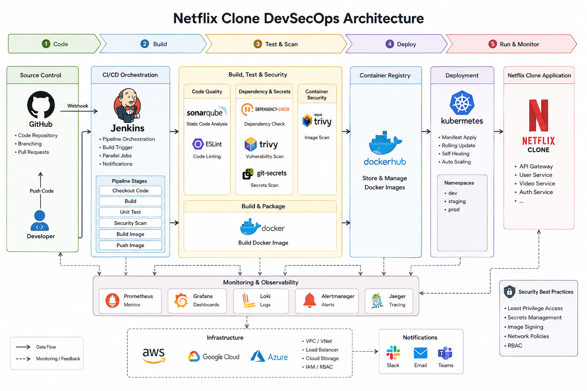
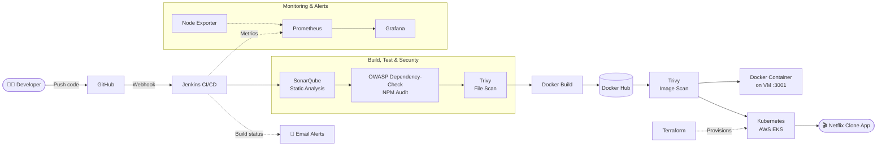

# 🎬 Netflix Clone – End-to-End DevSecOps CI/CD Pipeline

A complete DevSecOps project that builds, scans, containerizes, and deploys a Netflix clone (React + TMDB API) using **Jenkins, SonarQube, Trivy, OWASP Dependency-Check, Docker, Kubernetes (AWS EKS), Terraform, Prometheus, and Grafana**.

## 🏗 Architecture



> The diagram above is the high-level architecture. The Mermaid version below renders directly on GitHub and shows what this repository actually implements.



### Components

| Stage | Tool | Purpose |
|---|---|---|
| Source Control | GitHub | Code repository, webhook trigger |
| Orchestration | Jenkins | Runs all pipeline stages, sends notifications |
| Code Quality | SonarQube | Static code analysis and quality gate |
| Dependency Security | OWASP Dependency-Check, NPM Audit | Finds vulnerable libraries |
| Vulnerability Scan | Trivy | Scans source files and Docker images |
| Containerization | Docker, Docker Hub | Builds and stores the image |
| Infrastructure | Terraform, AWS (EC2, EKS, S3) | Provisions the EKS cluster |
| Deployment | Kubernetes (EKS) | Runs the app with `deployment.yml` and `service.yml` |
| Monitoring | Prometheus, Node Exporter, Grafana | Server and Jenkins metrics, dashboards |
| Notifications | Email (Gmail SMTP) | Build status with Trivy reports attached |

---

## 📑 Table of Contents

- [Overview](#-overview)
- [Tech Stack](#-tech-stack)
- [Pipeline Flow](#-pipeline-flow)
- [Prerequisites](#-prerequisites)
- [Setup Guide](#-setup-guide)
  - [Step 1 – Launch EC2 & Install Tools](#step-1--launch-ec2--install-terraform-kubectl-aws-cli)
  - [Step 2 – Jenkins, Docker, Trivy, SonarQube](#step-2--install-jenkins-docker-trivy--sonarqube)
  - [Step 3 – TMDB API Key](#step-3--create-a-tmdb-api-key)
  - [Step 4 – Prometheus, Node Exporter, Grafana](#step-4--prometheus-node-exporter--grafana)
  - [Step 5 – Jenkins ↔ Prometheus](#step-5--integrate-jenkins-with-prometheus)
  - [Step 6 – Email Notifications](#step-6--email-integration)
  - [Step 7 – Jenkins Plugins & Tools](#step-7--jenkins-plugins--tools)
  - [Step 8 – SonarQube Integration](#step-8--sonarqube-integration)
  - [Step 9 – EKS Provisioning with Terraform](#step-9--provision-aws-eks-with-terraform)
  - [Step 10 – Docker Build & Push](#step-10--docker-build--push)
  - [Step 11 – Kubernetes Deployment](#step-11--kubernetes-deployment)
- [Final Jenkins Pipeline](#-final-jenkins-pipeline)
- [Accessing the Application](#-accessing-the-application)
- [Monitoring](#-monitoring)
- [Troubleshooting](#-troubleshooting)
- [Security Notes](#-security-notes)
- [Cleanup](#-cleanup)

---

## 🔍 Overview

1. **Source & Version Control** – Developer pushes code to GitHub; a webhook triggers Jenkins.
2. **CI/CD Orchestration** – Jenkins runs every stage and sends notifications (GitHub status, email, Prometheus metrics).
3. **Security & Quality Gates** – SonarQube (static analysis), NPM Audit / OWASP Dependency-Check, Trivy file & image scans.
4. **Build & Containerization** – Docker build, push to Docker Hub, post-push image scan.
5. **Deployment** – Docker container on the VM and Kubernetes deployment on AWS EKS.
6. **Monitoring** – Prometheus + Grafana dashboards; email alerts on build results.

## 🧰 Tech Stack

| Category | Tools |
|---|---|
| Cloud / IaC | AWS (EC2, EKS, S3, IAM), Terraform |
| CI/CD | Jenkins (Declarative Pipeline) |
| Code Quality | SonarQube (LTS Community) |
| Security | Trivy, OWASP Dependency-Check, NPM Audit |
| Containers | Docker, Docker Hub |
| Orchestration | Kubernetes (EKS), kubectl |
| Monitoring | Prometheus, Node Exporter, Grafana |
| Notifications | Email (Gmail SMTP) |
| Application | React, TMDB API |

## 🔄 Pipeline Flow

```
DEVELOPER → GitHub → Jenkins CI/CD
                     ├─ Clean Workspace & Checkout
                     ├─ Code Analysis (SonarQube) + Quality Gate
                     ├─ Dependency Check (NPM Install / Audit / OWASP)
                     ├─ Trivy File Scan
                     ├─ Docker Build + Push
                     ├─ Trivy Image Scan
                     └─ Deployment
                          ├─ Docker Container (VM)
                          └─ Kubernetes Cluster (EKS)
                               ├─ Monitoring (Prometheus / Grafana)
                               └─ Alerts (Email)
```

## ✅ Prerequisites

- AWS account with permissions to create EC2, EKS, IAM, S3
- Docker Hub account
- GitHub account (fork of this repository)
- TMDB account (for API key)
- Gmail account with 2-Step Verification enabled (for an App Password)

---

## 🚀 Setup Guide

### Step 1 – Launch EC2 & Install Terraform, kubectl, AWS CLI

1. Launch an **Ubuntu 24.04**, **t2.large**, **50 GB** EC2 instance.
2. Create an **IAM role** with the required (admin for demo) permissions and attach it to the instance.
3. Create `script1.sh`:

```bash
#!/bin/bash
# Terraform
sudo apt install wget -y
wget -O- https://apt.releases.hashicorp.com/gpg | sudo gpg --dearmor -o /usr/share/keyrings/hashicorp-archive-keyring.gpg
echo "deb [signed-by=/usr/share/keyrings/hashicorp-archive-keyring.gpg] https://apt.releases.hashicorp.com $(lsb_release -cs) main" | sudo tee /etc/apt/sources.list.d/hashicorp.list
sudo apt update && sudo apt install terraform -y

# kubectl
sudo apt install curl -y
curl -LO https://dl.k8s.io/release/$(curl -L -s https://dl.k8s.io/release/stable.txt)/bin/linux/amd64/kubectl
sudo install -o root -g root -m 0755 kubectl /usr/local/bin/kubectl
kubectl version --client

# AWS CLI
curl "https://awscli.amazonaws.com/awscli-exe-linux-x86_64.zip" -o "awscliv2.zip"
sudo apt-get install unzip -y
unzip awscliv2.zip
sudo ./aws/install
```

### Step 2 – Install Jenkins, Docker, Trivy & SonarQube

**`script2.sh` – Java 17, Jenkins, Docker**

```bash
#!/bin/bash
sudo apt update -y
wget -O - https://packages.adoptium.net/artifactory/api/gpg/key/public | sudo tee /etc/apt/keyrings/adoptium.asc
echo "deb [signed-by=/etc/apt/keyrings/adoptium.asc] https://packages.adoptium.net/artifactory/deb $(awk -F= '/^VERSION_CODENAME/{print$2}' /etc/os-release) main" | sudo tee /etc/apt/sources.list.d/adoptium.list
sudo apt update -y
sudo apt install temurin-17-jdk -y
/usr/bin/java --version

# Jenkins
curl -fsSL https://pkg.jenkins.io/debian-stable/jenkins.io-2023.key | sudo tee /usr/share/keyrings/jenkins-keyring.asc > /dev/null
echo deb [signed-by=/usr/share/keyrings/jenkins-keyring.asc] https://pkg.jenkins.io/debian-stable binary/ | sudo tee /etc/apt/sources.list.d/jenkins.list > /dev/null
sudo apt-get update -y
sudo apt-get install jenkins -y
sudo systemctl start jenkins

# Docker
sudo apt-get update
sudo apt-get install ca-certificates curl gnupg -y
sudo install -m 0755 -d /etc/apt/keyrings
curl -fsSL https://download.docker.com/linux/ubuntu/gpg | sudo gpg --dearmor -o /etc/apt/keyrings/docker.gpg
sudo chmod a+r /etc/apt/keyrings/docker.gpg
echo \
  "deb [arch=$(dpkg --print-architecture) signed-by=/etc/apt/keyrings/docker.gpg] https://download.docker.com/linux/ubuntu \
  $(. /etc/os-release && echo "$VERSION_CODENAME") stable" | \
  sudo tee /etc/apt/sources.list.d/docker.list > /dev/null
sudo apt-get update
sudo apt-get install docker-ce docker-ce-cli containerd.io docker-buildx-plugin docker-compose-plugin -y
sudo usermod -aG docker ubuntu
newgrp docker
```

Jenkins UI: `http://<EC2-IP>:8080`

**`trivy.sh` – Trivy**

```bash
sudo apt-get install wget apt-transport-https gnupg lsb-release -y
wget -qO - https://aquasecurity.github.io/trivy-repo/deb/public.key | gpg --dearmor | sudo tee /usr/share/keyrings/trivy.gpg > /dev/null
echo "deb [signed-by=/usr/share/keyrings/trivy.gpg] https://aquasecurity.github.io/trivy-repo/deb $(lsb_release -sc) main" | sudo tee -a /etc/apt/sources.list.d/trivy.list
sudo apt-get update
sudo apt-get install trivy -y
```

**SonarQube container**

```bash
sudo usermod -aG docker jenkins          # preferred over chmod 777 on docker.sock
sudo systemctl restart docker jenkins
docker run -d --name sonar -p 9000:9000 sonarqube:lts-community
```

SonarQube UI: `http://<EC2-IP>:9000` (default `admin` / `admin` – change on first login)

### Step 3 – Create a TMDB API Key

1. Sign up / log in at [themoviedb.org](https://www.themoviedb.org/).
2. Go to **Settings → API → Create → Developer** and fill in the application details.
3. Copy the **API key** (v3). Store it as a Jenkins credential (see [Step 10](#step-10--docker-build--push)) – **never commit it**.

### Step 4 – Prometheus, Node Exporter & Grafana

Launch a **separate Ubuntu 24.04 t2.medium** instance for monitoring.

<details>
<summary><b>Install Prometheus</b></summary>

```bash
sudo apt update
sudo useradd --system --no-create-home --shell /bin/false prometheus
wget https://github.com/prometheus/prometheus/releases/download/v2.47.1/prometheus-2.47.1.linux-amd64.tar.gz
tar -xvf prometheus-2.47.1.linux-amd64.tar.gz
sudo mkdir -p /data /etc/prometheus
cd prometheus-2.47.1.linux-amd64/
sudo mv prometheus promtool /usr/local/bin/
sudo mv consoles/ console_libraries/ /etc/prometheus/
sudo mv prometheus.yml /etc/prometheus/prometheus.yml
sudo chown -R prometheus:prometheus /etc/prometheus/ /data/
cd ~ && rm -rf prometheus-2.47.1.linux-amd64.tar.gz
prometheus --version
```

`/etc/systemd/system/prometheus.service`:

```ini
[Unit]
Description=Prometheus
Wants=network-online.target
After=network-online.target
StartLimitIntervalSec=500
StartLimitBurst=5

[Service]
User=prometheus
Group=prometheus
Type=simple
Restart=on-failure
RestartSec=5s
ExecStart=/usr/local/bin/prometheus \
  --config.file=/etc/prometheus/prometheus.yml \
  --storage.tsdb.path=/data \
  --web.console.templates=/etc/prometheus/consoles \
  --web.console.libraries=/etc/prometheus/console_libraries \
  --web.listen-address=0.0.0.0:9090 \
  --web.enable-lifecycle

[Install]
WantedBy=multi-user.target
```

```bash
sudo systemctl enable prometheus
sudo systemctl start prometheus
sudo systemctl status prometheus
```

Prometheus UI: `http://<MONITORING-IP>:9090`

</details>

<details>
<summary><b>Install Node Exporter</b></summary>

```bash
sudo useradd --system --no-create-home --shell /bin/false node_exporter
wget https://github.com/prometheus/node_exporter/releases/download/v1.6.1/node_exporter-1.6.1.linux-amd64.tar.gz
tar -xvf node_exporter-1.6.1.linux-amd64.tar.gz
sudo mv node_exporter-1.6.1.linux-amd64/node_exporter /usr/local/bin/
rm -rf node_exporter*
node_exporter --version
```

`/etc/systemd/system/node_exporter.service`:

```ini
[Unit]
Description=Node Exporter
Wants=network-online.target
After=network-online.target
StartLimitIntervalSec=500
StartLimitBurst=5

[Service]
User=node_exporter
Group=node_exporter
Type=simple
Restart=on-failure
RestartSec=5s
ExecStart=/usr/local/bin/node_exporter --collector.logind

[Install]
WantedBy=multi-user.target
```

```bash
sudo systemctl enable node_exporter
sudo systemctl start node_exporter
sudo systemctl status node_exporter
```

Node Exporter: `http://<MONITORING-IP>:9100`

</details>

<details>
<summary><b>Install Grafana</b></summary>

```bash
sudo apt-get install -y apt-transport-https software-properties-common
wget -q -O - https://packages.grafana.com/gpg.key | sudo apt-key add -
echo "deb https://packages.grafana.com/oss/deb stable main" | sudo tee -a /etc/apt/sources.list.d/grafana.list
sudo apt-get update
sudo apt-get -y install grafana
sudo systemctl enable grafana-server
sudo systemctl start grafana-server
sudo systemctl status grafana-server
```

Grafana UI: `http://<MONITORING-IP>:3000` (default `admin` / `admin`)

1. **Connections → Data sources → Add → Prometheus** → URL `http://localhost:9090`
2. **Dashboards → Import** → ID **1860** (Node Exporter Full) → select Prometheus → Load

</details>

### Step 5 – Integrate Jenkins with Prometheus

1. Jenkins → **Manage Jenkins → Plugins → Available** → install **Prometheus metrics** plugin and restart.
2. On the Prometheus server, edit `/etc/prometheus/prometheus.yml`:

```yaml
  - job_name: 'jenkins'
    metrics_path: '/prometheus'
    static_configs:
      - targets: ['<JENKINS-IP>:8080']
```

3. Validate and reload:

```bash
promtool check config /etc/prometheus/prometheus.yml
sudo systemctl restart prometheus
# or: curl -X POST http://localhost:9090/-/reload
```

4. Verify at `http://<MONITORING-IP>:9090/targets`.
5. In Grafana import dashboard ID **9964** (Jenkins performance & health).

### Step 6 – Email Integration

1. Install the **Email Extension** plugin in Jenkins.
2. In your Google Account → **Security**, enable **2-Step Verification**, then create an **App Password** (name: `Jenkins`).
3. **Manage Jenkins → System → E-mail Notification**

| Field | Value |
|---|---|
| SMTP server | `smtp.gmail.com` |
| Use SMTP Authentication | ✔ |
| Username | `<your-gmail>` |
| Password | `<app-password>` |
| Use SSL | ✔ |
| SMTP Port | `465` |

4. **Manage Jenkins → Credentials** → add *Username with password* (ID: `mail`).
5. **Extended E-mail Notification**: SMTP `smtp.gmail.com`, port `465`, credentials `mail`, use SSL, default triggers: **Always**, **Failure – Any**.

### Step 7 – Jenkins Plugins & Tools

**Plugins** (Manage Jenkins → Plugins → Available):

- Eclipse Temurin Installer
- SonarQube Scanner
- NodeJS
- OWASP Dependency-Check
- Docker, Docker Commons, Docker Pipeline, Docker API, Docker-build-step
- Terraform
- Kubernetes, Kubernetes CLI, Kubernetes Client API, Kubernetes Credentials

**Tools** (Manage Jenkins → Tools):

| Tool | Name | Configuration |
|---|---|---|
| JDK | `jdk24` | Install automatically → adoptium.net → `jdk-24+36` |
| SonarQube Scanner | `sonar-scanner` | Install automatically (latest) |
| NodeJS | `node24` | Install from nodejs.org → v24.x |
| Docker | `docker` | Install automatically → docker.com (latest) |
| Terraform | `terraform` | Uncheck auto-install; directory `/usr/bin/` (check with `which terraform`) |
| Dependency-Check | `DP-Check` | Install from github.com (latest) |

### Step 8 – SonarQube Integration

1. SonarQube → **Administration → Security → Users → Tokens** → generate token named `netflix`.
2. Jenkins → **Manage Jenkins → Credentials** → *Secret text*, ID: `sonar-token`.
3. Jenkins → **Manage Jenkins → System → SonarQube servers**
   - Name: `sonar-server`
   - URL: `http://<EC2-IP>:9000`
   - Token: `sonar-token`
4. SonarQube → **Administration → Configuration → Webhooks → Create**
   - Name: `Jenkins`
   - URL: `http://<EC2-IP>:8080/sonarqube-webhook/`

### Step 9 – Provision AWS EKS with Terraform

1. Create a **private S3 bucket** for the Terraform state (e.g. `<your-unique-bucket-name>`) and reference it in the Terraform backend config.
2. Create a Jenkins **Pipeline** job `EKSJOB`, check **This project is parameterized** → *Choice Parameter* `action` with choices `apply`, `destroy`.

```groovy
pipeline {
    agent any
    stages {
        stage('Checkout from Git') {
            steps { git branch: 'main', url: 'https://github.com/<your-username>/devsecops-netflix.git' }
        }
        stage('Terraform version') {
            steps { sh 'terraform --version' }
        }
        stage('Terraform init') {
            steps { dir('EKS_TERRAFORM') { sh 'terraform init' } }
        }
        stage('Terraform validate') {
            steps { dir('EKS_TERRAFORM') { sh 'terraform validate' } }
        }
        stage('Terraform plan') {
            steps { dir('EKS_TERRAFORM') { sh 'terraform plan' } }
        }
        stage('Terraform apply/destroy') {
            steps { dir('EKS_TERRAFORM') { sh 'terraform ${action} --auto-approve' } }
        }
    }
}
```

3. Run with `apply`, then verify:

```bash
aws eks list-clusters --region ap-south-1
aws eks update-kubeconfig --region ap-south-1 --name EKS_CLUSTER
```

### Step 10 – Docker Build & Push

1. Jenkins → **Credentials** → *Username with password*: your Docker Hub username/password (or access token), ID: `docker`.
2. Add a *Secret text* credential for the TMDB key, ID: `tmdb-api-key`.
3. If Docker login fails on newer Docker versions:

```bash
sudo systemctl edit docker.service
# add:
# [Service]
# Environment=DOCKER_MIN_API_VERSION=1.24
sudo systemctl restart docker
```

### Step 11 – Kubernetes Deployment

1. On the Jenkins server:

```bash
aws eks update-kubeconfig --name EKS_CLUSTER --region ap-south-1
cat ~/.kube/config      # save content locally as secret.txt
kubectl get nodes
```

2. Jenkins → **Credentials** → *Secret file* → upload `secret.txt`, ID: `k8s`.
3. In your fork, update the image name in `Kubernetes/deployment.yml` to your Docker Hub repository.
4. Remove any old container before running the pipeline:

```bash
docker ps -a
docker stop <container-id> && docker rm <container-id>
```

---

## 🧪 Final Jenkins Pipeline

```groovy
pipeline {
    agent any
    tools {
        jdk 'jdk24'
        nodejs 'node24'
    }
    environment {
        SCANNER_HOME = tool 'sonar-scanner'
    }
    stages {
        stage('Clean Workspace') {
            steps { cleanWs() }
        }
        stage('Checkout from Git') {
            steps { git branch: 'main', url: 'https://github.com/<your-username>/devsecops-netflix.git' }
        }
        stage('SonarQube Analysis') {
            steps {
                withSonarQubeEnv('sonar-server') {
                    sh '''$SCANNER_HOME/bin/sonar-scanner \
                          -Dsonar.projectName=netflix \
                          -Dsonar.projectKey=netflix'''
                }
            }
        }
        stage('Quality Gate') {
            steps {
                script { waitForQualityGate abortPipeline: false, credentialsId: 'sonar-token' }
            }
        }
        stage('Install Dependencies') {
            steps { sh 'npm install' }
        }
        stage('OWASP Dependency Check') {
            steps {
                dependencyCheck additionalArguments: '--scan ./ --disableYarnAudit --disableNodeAudit', odcInstallation: 'DP-Check'
                dependencyCheckPublisher pattern: '**/dependency-check-report.xml'
            }
        }
        stage('Trivy FS Scan') {
            steps { sh 'trivy fs . > trivyfs.txt' }
        }
        stage('Docker Build & Push') {
            steps {
                script {
                    withDockerRegistry(credentialsId: 'docker', toolName: 'docker') {
                        withCredentials([string(credentialsId: 'tmdb-api-key', variable: 'TMDB_KEY')]) {
                            sh 'docker build --build-arg TMDB_V3_API_KEY=$TMDB_KEY -t netflix .'
                        }
                        sh 'docker tag netflix <dockerhub-username>/netflix:latest'
                        sh 'docker push <dockerhub-username>/netflix:latest'
                    }
                }
            }
        }
        stage('Trivy Image Scan') {
            steps { sh 'trivy image <dockerhub-username>/netflix:latest > trivyimage.txt' }
        }
        stage('Deploy to Container') {
            steps { sh 'docker run -d --name netflix -p 3001:80 <dockerhub-username>/netflix:latest' }
        }
        stage('Deploy to Kubernetes') {
            steps {
                script {
                    dir('Kubernetes') {
                        withKubeConfig(credentialsId: 'k8s') {
                            sh 'kubectl apply -f deployment.yml'
                            sh 'kubectl apply -f service.yml'
                        }
                    }
                }
            }
        }
    }
    post {
        always {
            emailext attachLog: true,
                subject: "'${currentBuild.result}'",
                body: "Project: ${env.JOB_NAME}<br/>" +
                      "Build Number: ${env.BUILD_NUMBER}<br/>" +
                      "URL: ${env.BUILD_URL}<br/>",
                to: '<your-email>',
                attachmentsPattern: 'trivyfs.txt,trivyimage.txt'
        }
    }
}
```

---

## 🌐 Accessing the Application

| Component | URL |
|---|---|
| Jenkins | `http://<JENKINS-IP>:8080` |
| SonarQube | `http://<JENKINS-IP>:9000` |
| Netflix app (Docker) | `http://<JENKINS-IP>:3001` |
| Prometheus | `http://<MONITORING-IP>:9090` |
| Node Exporter | `http://<MONITORING-IP>:9100` |
| Grafana | `http://<MONITORING-IP>:3000` |

**Kubernetes access:**

```bash
kubectl get all
kubectl get svc
```

To expose the service through a load balancer:

```bash
kubectl patch svc netflix-app -n default -p '{"spec": {"type": "LoadBalancer"}}'
```

Wait ~2 minutes, then open the `EXTERNAL-IP` / DNS name shown by `kubectl get svc`.

## 📊 Monitoring

- **Node Exporter Full** dashboard (ID `1860`) – server CPU, memory, disk, network.
- **Jenkins Performance & Health** dashboard (ID `9964`) – build durations, success/failure rates, queue.
- **Email alerts** – every build sends status and logs, with Trivy reports attached.

## 🛠 Troubleshooting

| Problem | Fix |
|---|---|
| `container name "netflix" already in use` | `docker stop netflix && docker rm netflix`, then re-run the pipeline |
| SonarQube is down after reboot | `docker start sonar` |
| Docker login error in Jenkins | Set `DOCKER_MIN_API_VERSION=1.24` (see Step 10) |
| `permission denied` on Docker socket | `sudo usermod -aG docker jenkins` and restart Jenkins |
| Quality gate never returns | Check the SonarQube webhook URL ends with `/sonarqube-webhook/` |
| Prometheus target is down | Run `promtool check config` and check the security-group ports (8080, 9090, 9100) |

## 🔐 Security Notes

- **Never commit secrets** (TMDB key, SonarQube token, Docker/Gmail passwords). Store them in Jenkins Credentials.
- Prefer `usermod -aG docker jenkins` to `chmod 777 /var/run/docker.sock`.
- Use least-privilege IAM policies instead of admin access outside of demos.
- Restrict security-group inbound rules to your own IP where possible.
- Use a Docker Hub access token instead of your account password.

## 🧹 Cleanup

To avoid AWS charges:

1. Run the `EKSJOB` pipeline with `action = destroy`.
2. Terminate the EC2 instances (Jenkins server and monitoring server).
3. Delete the S3 bucket used for Terraform state.
4. Remove unused IAM roles and security groups.

---

## 🤝 Contributing

Fork the repo, create a feature branch, and open a pull request.

## 📄 License

This project is for educational purposes. Netflix and the Netflix logo are trademarks of Netflix, Inc.; this project is not affiliated with Netflix.
